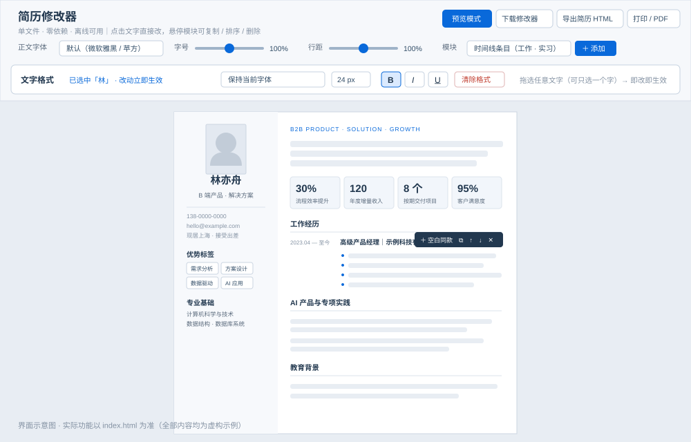

# 单文件简历修改器 · Resume Editor

一个**零依赖、纯前端、离线可用**的 A4 单页简历编辑器。整个工具就是一个 `index.html`：双击打开即可编辑，不联网、不上传、不引入任何 CDN 或第三方脚本，你的简历内容只留在自己的浏览器里。

> 仓库内所有姓名、公司、学校、联系方式和数字都是**虚构示例**，不含任何真实个人信息。

 



## 快速开始

1. 下载 [`index.html`](./index.html)（或克隆本仓库）。
2. 用 **Chrome / Edge** 双击打开（不建议在在线预览器里打开，本地相对资源与 localStorage 行为会不同）。
3. 直接点击简历中的任意文字修改；点顶部「更换照片」换成自己的证件照。
4. 定稿后点「**导出简历 HTML**」得到干净的单文件简历，或点「**打印 / 存 PDF**」存成 PDF。

## 在线使用（GitHub Pages）

仓库设为 Public 后：`Settings → Pages → Build and deployment → Deploy from a branch → 选 main / (root) → Save`。约 1 分钟后即可访问：

```
https://<你的用户名>.github.io/resume-editor/
```

因为所有资源都内嵌在单文件里，Pages 版无需任何构建步骤，别人打开链接就能直接编辑。Pages 是 https 源，localStorage 自动保存同样可用。

## 功能一览

| 分类 | 能力 |
| --- | --- |
| 全局排版 | 正文字体（12 种字体栈 + 自定义字体名）、标题字体、字号 75%–135%、行距 85%–140%、字距 −0.5–1.5px，实时联动全篇；一键重置 |
| 逐字格式 | WPS 风格顶部常驻「文字格式」栏：拖选任意文字（可只选一个字）→ 自动回显当前字体/字号 → 改字体、改 px 字号、**B 加粗 / I 斜体 / U 下划线**（也支持 `Ctrl+B/I/U`）→ 即改即生效；「清除格式」恢复跟随全局 |
| 局部格式清单 | 右侧「局部格式 (N)」列出每一处的文字、字体、字号与粗/斜/下划线状态，可「定位」继续改或单条清除 |
| 模块编辑 | 悬停任意模块出现操作条：`＋ 空白同款`（复制版式清空文字）、`⧉ 完整副本`（连内容复制）、`↑` `↓` 排序、`✕` 删除；顶部可新增时间线、项目、教育、数据卡片、优势标签、侧栏分区、章节标题及整块章节组合 |
| 保存与导出 | 改动自动存入浏览器 localStorage，刷新自动恢复；「恢复初始模板」一键还原；导出纯净简历 HTML（不含任何编辑界面与脚本）；「下载修改器」导出仍可继续编辑的版本；照片内嵌进文件，不依赖外部图片 |
| 打印 | A4 单页边界提示、内容超页提示，打印时自动分页不裁内容；编辑工具条在打印与导出中完全不出现 |

## 换成自己的简历

**最简单**：直接在页面上点文字改，所有内容都可编辑，改完点「导出简历 HTML」。

**想换整套版式内容**：用文本编辑器打开 `index.html`，找到 `<main class="page" id="resume"> ... </main>`，把里面的示例 HTML 换成自己的内容即可。请**保留**这些约定，编辑功能才能识别模块：

- `class="side" / "main" / "page"` —— 两栏与页面容器
- `data-module` + `data-label` —— 标记可复制 / 排序 / 删除的模块（`timeline`、`project`、`edu`、`number`、`chip`、`sideblock`、`section`）
- 各模块内部的 `when / entry / org / ul / li / b / small` 等 class —— 沿用原有样式

改完后「恢复初始模板」会回到你自己写入的那份内容（初始值取自页面 DOM，不是硬编码）。

## 用 WorkBuddy Skill 自动套版（可选）

不想手动搬文字？仓库自带一个 Skill：上传任意简历，自动套进这个版式，并生成**仍可用编辑器继续修改**的 HTML。

### 安装

把 `skills/resume-to-template/` 整个目录复制到用户级 skills 目录：

- Windows：`C:\Users\<用户名>\.workbuddy\skills\`
- macOS / Linux：`~/.workbuddy/skills/`

也可以解压单独发布的 `resume-to-template.zip` 到同一目录。复制后重新开启会话即可生效。

### 使用

在 WorkBuddy 里上传简历（PDF / DOCX / HTML / Markdown / TXT），说一句：

> 用这个模板把我的简历改成可编辑版本

Skill 会提取文本 → 把内容整理成结构化 JSON → 注入模板 → 输出 `<姓名>_简历修改器.html`。生成的文件保留完整编辑能力，双击可继续改字体、加粗、增删模块、导出 PDF。

### 设计要点

- 模型只产出内容数据，**绝不改写 50KB 的编辑器代码**；注入由 `scripts/build_editor.py` 完成，模板代码逐字节不变。
- 只搬运原文事实，不编造公司、学校、数字；指标卡凑不满 4 张就少放。
- 每份简历生成独立的 localStorage 键，多份简历不会互相覆盖自动保存。
- 全程本地处理、不联网；生成的文件含真实个人信息，请勿提交到公开仓库（`.gitignore` 已兜底）。

字段规范与工作流见 `skills/resume-to-template/SKILL.md` 和 `references/schema.md`。

## 快捷键与行为

| 操作 | 说明 |
| --- | --- |
| `Ctrl/⌘ + B / I / U` | 对选中文字加粗 / 斜体 / 下划线 |
| 拖选文字 | 顶部「文字格式」栏自动启用并回显该处字体字号；未选中时控件置灰 |
| `Esc` | 取消当前选中 / 关闭局部格式面板 |
| 悬停模块 | 出现复制、排序、删除操作条 |

局部字号是**固定 px**，不会随全局字号滑块缩放；局部设置优先级高于全局设置。自动保存按「当前浏览器 + 当前文件路径」隔离，换路径或换浏览器不会带过去，所以定稿后请务必导出落盘。

## 隐私说明

- 全部逻辑在本地运行，没有任何网络请求、统计、字体 CDN 或外部图片依赖。
- 编辑内容保存在浏览器 `localStorage`，不会离开本机。
- 示例证件照是内嵌 SVG 占位图；「更换照片」会把新照片以 data URI 内嵌进 HTML，**只在你点导出时才写进导出的文件**。
- Skill 生成的文件含真实简历，属于本地产物；请勿把含真实个人信息的简历、证件照或 PDF 提交到公开仓库。

## 目录结构

```
resume-editor/
├── index.html                  # 全部内容：样式 + 示例简历 + 编辑器逻辑（单文件）
├── README.md                   # 本说明
├── LICENSE                     # MIT
├── preview.svg                 # 界面示意图
├── .gitignore                  # 防止误提交个人简历 / 照片 / PDF
└── skills/
    └── resume-to-template/     # WorkBuddy Skill：任意简历 → 本模板
        ├── SKILL.md
        ├── scripts/
        │   ├── extract_resume.py    # 多格式简历文本提取
        │   └── build_editor.py      # JSON 注入模板，生成可编辑 HTML
        ├── references/schema.md     # 内容字段规范与映射规则
        └── assets/editor-template.html  # 模板快照
```

## 已知限制

- 建议 Chrome / Edge；Safari 与 Firefox 的 `contenteditable` 选区行为略有差异。
- 在线 HTML 预览器通常无法使用同目录本地文件与 localStorage，请下载到本地打开（GitHub Pages 的 https 源不受此限制）。
- 编辑状态下会显示 A4 边界虚线与操作条，仅用于辅助，打印 / 导出时不会出现。
- PDF 简历的文本提取依赖可选的 `pypdf` / `PyPDF2` / `pdfplumber` / `PyMuPDF`；扫描件需先 OCR。

## 许可证

[MIT](./LICENSE) — 随便用，欢迎 PR 改进字体栈、模块模板和打印样式。
